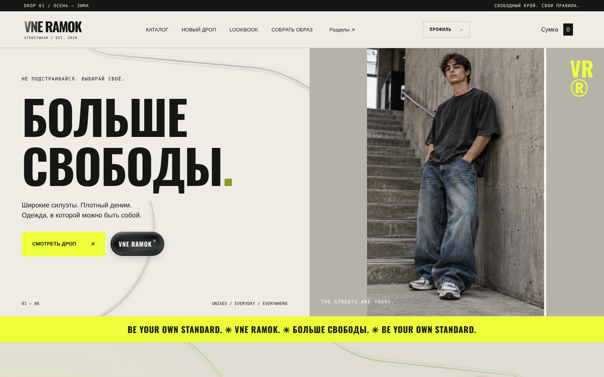

# VNE RAMOK 26 · Digital Fashion Studio

> **Portfolio demonstration • No real payments**

**[Live demo](https://vne-ramok-portfolio.onrender.com/) · [GitHub repository](https://github.com/Aydenxvi/vne-ramok)**

Public demo: explore the 3D studio, add products to the bag and print a fictional receipt. Registration/admin and real payments are disabled.


An independent streetwear shopping experience with a fully interactive catalog, animated lookbook, original 3D outfit builder, demo checkout with a printed receipt, customer accounts, and a Node.js / SQLite administration system.



## Highlights

- **Original 3D Outfit Studio:** seven coordinated GLB assets (mannequin, T-shirt, hoodie, bomber, jeans, cargo and beanie), all made for one neutral pose and common coordinates. Mouse/touch orbit, zoom, color variants and outfit totals. GLB files are under 160 KB combined. Model source is in [`tools/build-studio-23.py`](tools/build-studio-23.py).
- **Commerce UI:** responsive products, variants, size selection, lookbook hotspots, cart, promo codes and paper-receipt animation after demo checkout.
- **Backend:** Node.js 22.13+, built-in SQLite, scrypt passwords, session cookies, server-side price/stock validation, stock-restocking on order cancellation, admin dashboard and photo upload.
- **Portfolio public demo:** `PUBLIC_DEMO=1` allows catalog, Outfit Studio and fake checkout while disabling accounts/admin and **not storing contact details**. No card payments, no shipping integrations.
- **Performance:** on-demand WebGL rendering, local image assets and reduced-motion support.

## Local launch

On Windows, double-click `start_windows.bat`.

Or use:

```bash
node server.js
```

Visit **http://localhost:3000**. Requires Node.js **22.13+**. To create a local admin account:

```bash
npm run admin:setup
```

Admin interface: `http://localhost:3000/admin.html`. The local version saves accounts and **unpaid** order requests to `data/vneramok.sqlite`. No real payment is charged.

## Public portfolio preview

```bash
# macOS/Linux
PUBLIC_DEMO=1 node server.js
```

For Windows PowerShell:

```powershell
$env:PUBLIC_DEMO="1"
node server.js
```

Demo checkout uses fictional details and returns a visual receipt without saving customer data or changing stock. Registration/admin APIs are blocked. For safe deployment, see [**GITHUB_RENDER_25_RU.md**](docs/GITHUB_RENDER_25_RU.md) and the supplied `Dockerfile` + `render.yaml`.

**Hosting not included:** this archive does not publish your code or create a live URL. You must connect your own GitHub repository and hosting account.

## Tech stack

| Layer | Technology |
| --- | --- |
| UI | Vanilla JavaScript, semantic HTML, modular CSS |
| 3D | Original procedural GLB assets, lightweight WebGL viewer; no animation loop while idle |
| Backend | Node.js HTTP and `node:sqlite`, zero runtime npm packages |
| Auth | Scrypt-hashed passwords, random hashed session tokens, HttpOnly same-site cookies |
| QA | In-process unit checks, server integration tests, public-demo privacy checks |
| Delivery | Docker, Render Blueprint, local Windows launcher |

## Tests

```bash
npm test
```

Runs 54 in-process checks, 9 local HTTP integration checks, and a public-demo integration smoke check. The WebGL image is not validated on all graphics drivers: test it on your own machine before making the demo public.

## Source organization

`wardrobe.js` handles interactive selections; `outfit-glb.js` streams only selected garments; `assets/studio-23/` has original aligned models. `server/routes/` contains catalog, account, order and admin APIs; `server/public-demo.js` is the privacy guard for hosted demos. `docs/CASE_STUDY.md` describes the architecture and earlier stages.

All 3D models in version 23 are original procedural geometry. Older third-party models and their large binary files are not bundled. Portfolio photographs and branding remain demonstration assets.

**Limitations:** stylized 3D is not a photoreal fitting room or fabric simulation; public mode intentionally disables login, admin operations and real order persistence. Neither mode accepts real payment. Do not use this project as a production commerce store without a comprehensive security/privacy review.

## Publish VNE RAMOK 25

[**GitHub + Render step-by-step guide (Russian)**](docs/GITHUB_RENDER_25_RU.md). The public demo locks buyer fields to fictional contact information; no real personal information is required.

## Version 26 — Portfolio polish

- Public header links to the source repository instead of disabled account login; local login is unchanged.
- Public checkout explicitly says “Оформить демо-заказ”, while local order creation keeps “Отправить заявку”.
- Updated footer version, SVG favicon, Open Graph / X (Twitter) social preview.
- The preview image is a crop of the included storefront screenshot, not a newly generated depiction.
- Existing receipt animation, 3D Studio, API, and persistent local accounts are unchanged.
