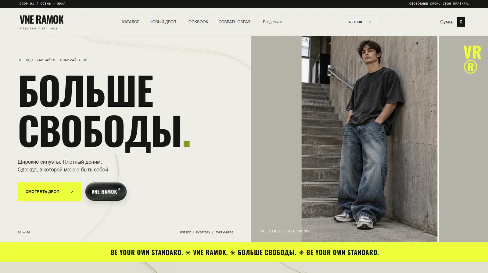
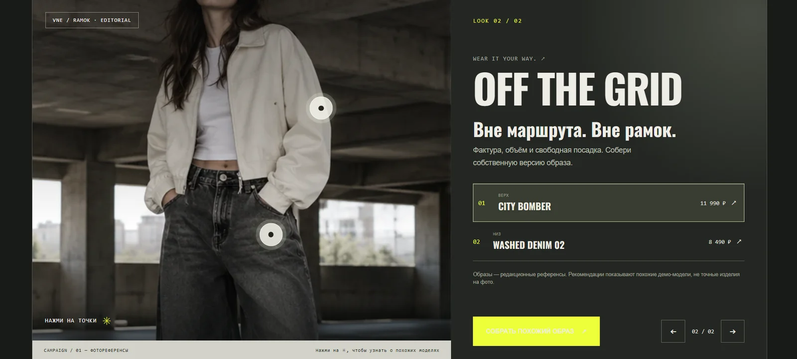
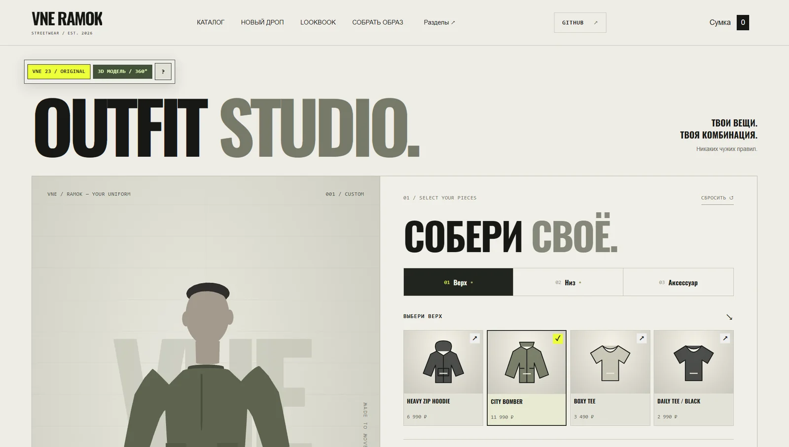
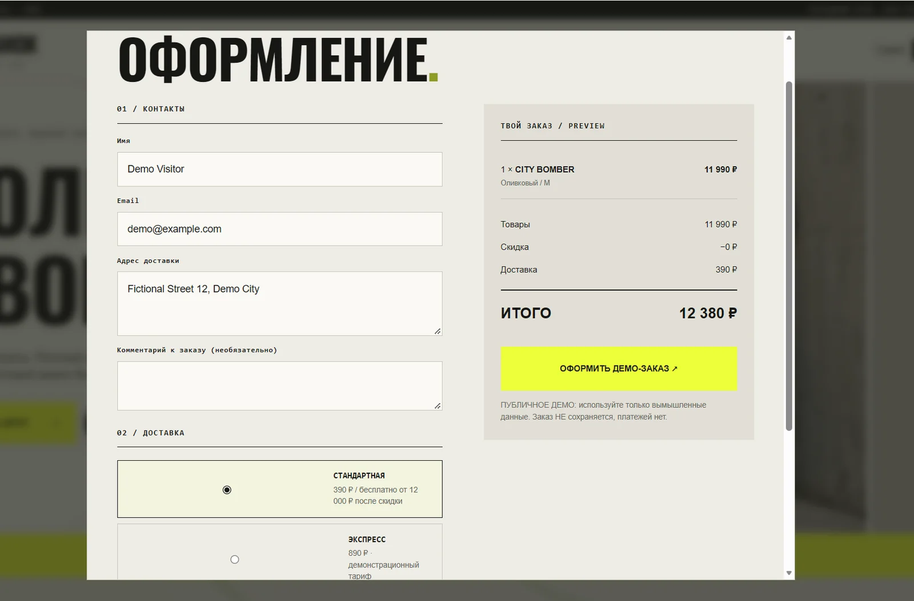
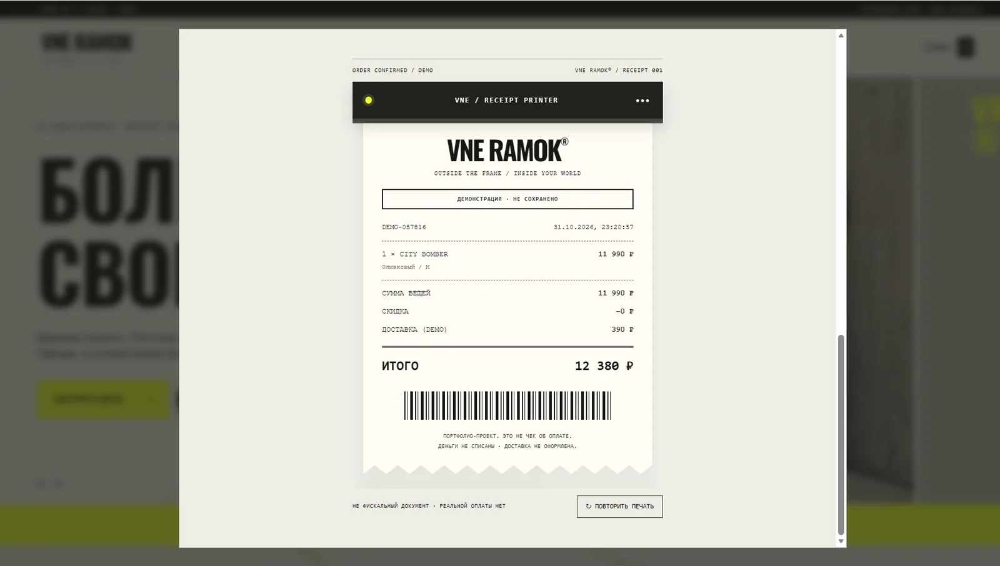
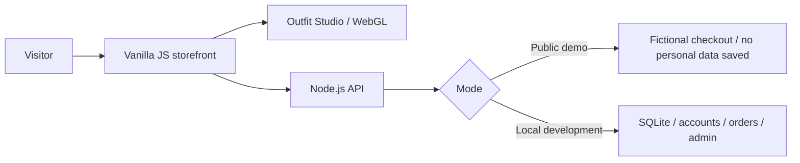

# VNE RAMOK — Project case study

**Interactive fashion commerce · Full-stack portfolio demo · 2026**

**[Live experience](https://vne-ramok-portfolio.onrender.com/) · [GitHub](https://github.com/Aydenxvi/vne-ramok) · [Screenshots](SCREENSHOTS.md)**

## Context

VNE RAMOK is an experimental streetwear storefront designed to combine strong editorial identity with real interface behavior. The core challenge was to build a memorable shopping experience that demonstrates both **frontend craft** and **backend engineering** without presenting fictional payments as real commerce.

The art direction centers on oversized condensed typography, a stone/off-white base, near-black surfaces, and electric-lime accents. Interactions are restrained enough to retain usability: product stacks, lookbook hotspots, tactile controls, animated navigation, and a printed-receipt finale.

## Experience and key interactions

**1 — Discovery.** Visitors enter through a bold campaign hero, then explore animated new arrivals and editorial images. Hover and scroll effects are designed to complement, not replace, clear navigation.

**2 — Editorial lookbook.** Clickable outfit hotspots connect fashion storytelling with the actual product catalog.

**3 — Interactive outfit builder.** An original lightweight mannequin and modular garment set allow tops, trousers and accessories to change in a rotatable 3D scene. The scene renders on demand and selected outfit data remains connected to the cart. This is a stylized configurator, not size-accurate garment simulation.

**4 — Checkout and feedback.** A coherent shopping flow takes a selected product through cart, delivery choice, price calculation and a fictional order. The memorable final touch is a receipt emerging from a branded printer — clearly labelled as a demo.

## Engineering decisions

| Challenge | Approach |
| --- | --- |
| Distinctive UI without heavy dependencies | Vanilla JS, CSS motion, progressive interactions |
| 3D outfits from incompatible external assets | Unified custom procedural GLB garment set with shared coordinates |
| Graphics smoothness | On-demand WebGL rendering, selective visual effects and fallbacks |
| Reliable order calculations | Recompute prices and stock server-side in local mode |
| Protect demo visitors | `PUBLIC_DEMO=1` disables accounts/admin and prevents order/contact persistence |
| Maintainability after many iterations | Split frontend features and backend routes into focused files and add tests |

## How it works

Public/demo and local modes share the same core interface but have intentionally different permissions. The hosted version does not accept real payments, even though the checkout and receipt are interactive.

## Quality, accessibility and honest limits

The project contains unit and HTTP integration tests (`npm test`), supports reduced-motion preferences and includes desktop/mobile responsive layouts. Its 3D viewer is a stylized representation, and the supplied screenshots are evidence of appearance on a particular desktop rather than a guarantee of rendering across every device.

This remains a **portfolio project**, not a security-audited production store: real payment gateways, shipping carriers, production privacy infrastructure and full catalog operations are out of scope.

## Outcome

A publicly accessible interactive demo on Render, with documented source code on GitHub, a 3D product customization experience, a working local Node.js/SQLite backend and a fictional commerce journey that culminates in an animated paper receipt.

**[Open VNE RAMOK](https://vne-ramok-portfolio.onrender.com/) · [View code](https://github.com/Aydenxvi/vne-ramok)**
