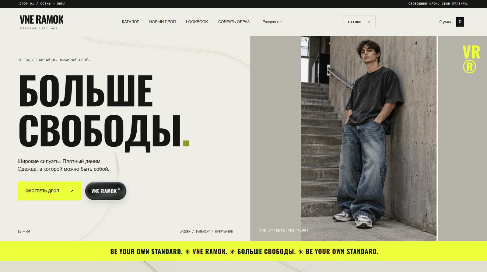
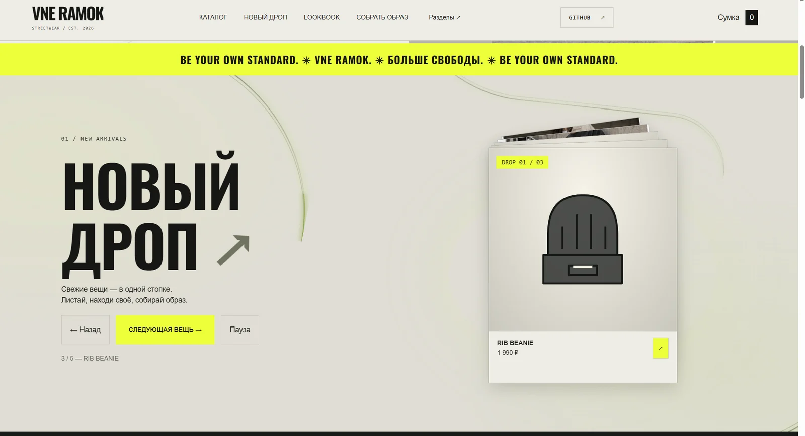
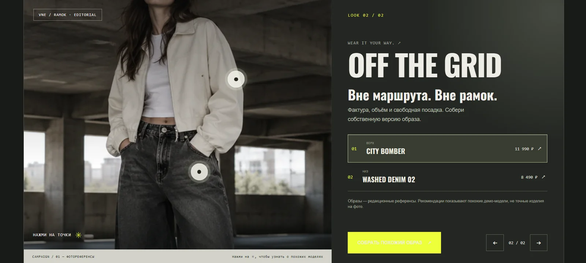
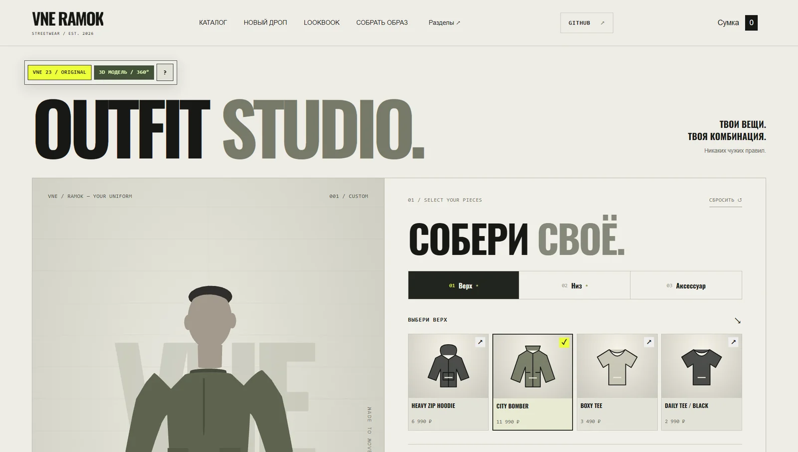
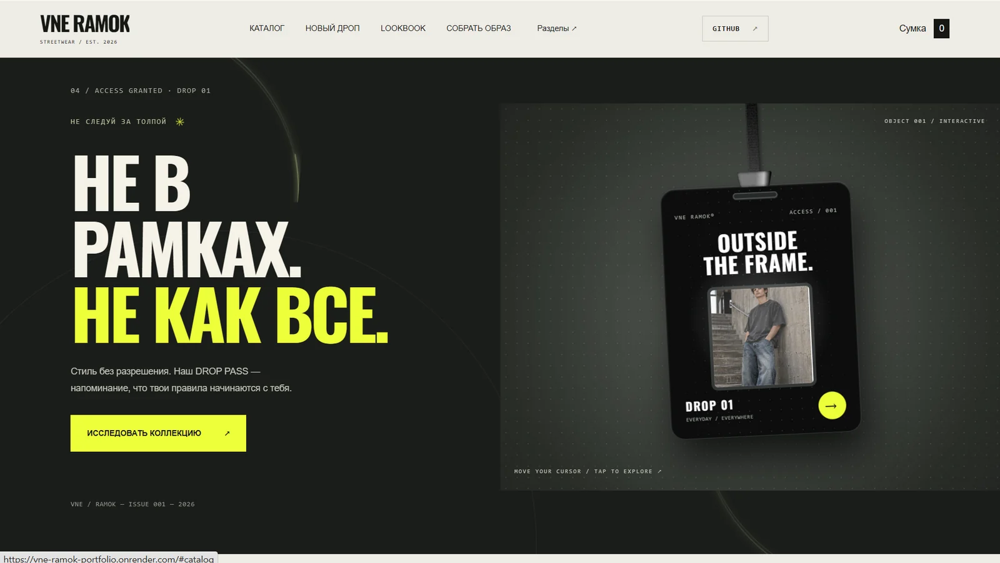
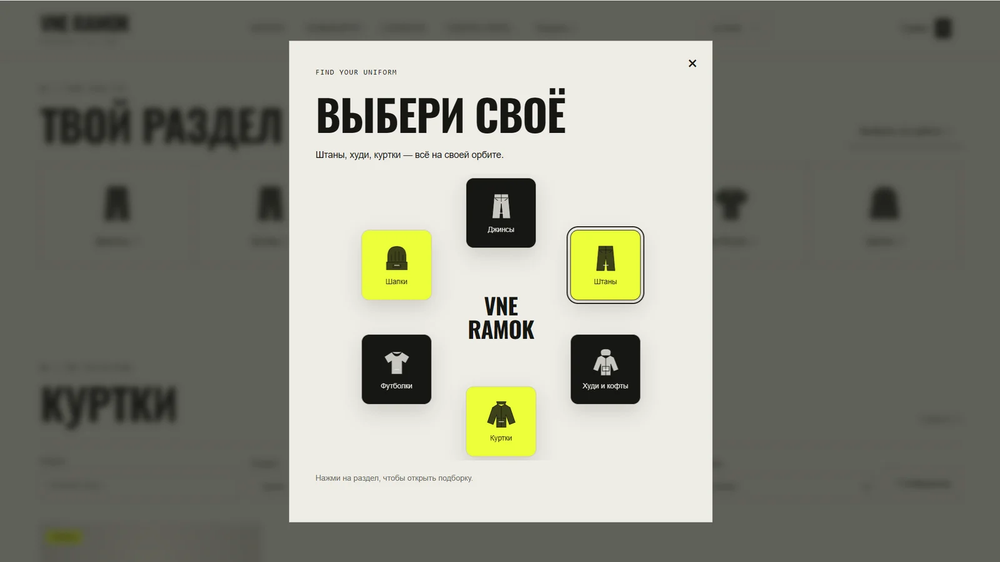
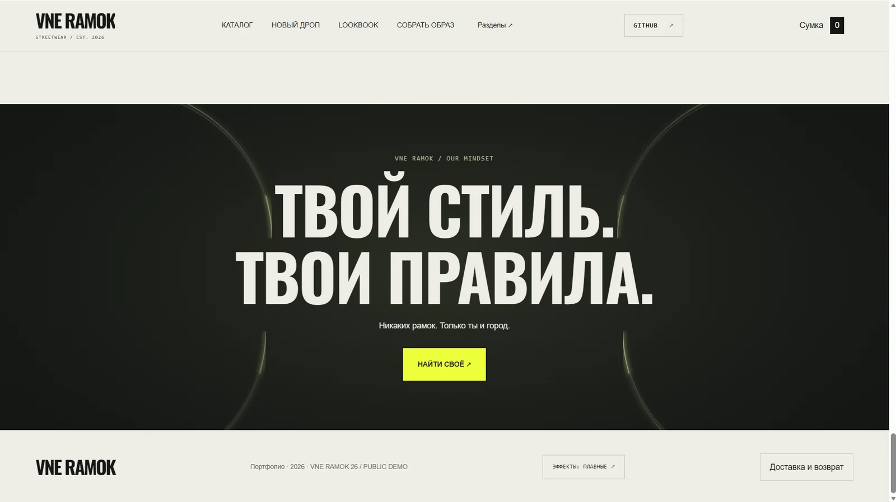
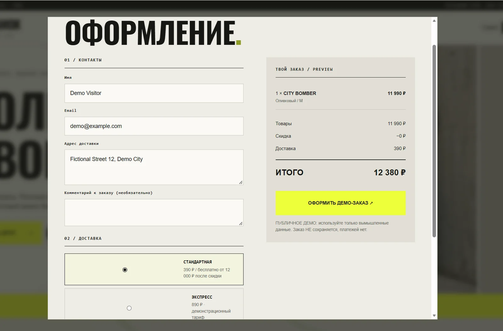
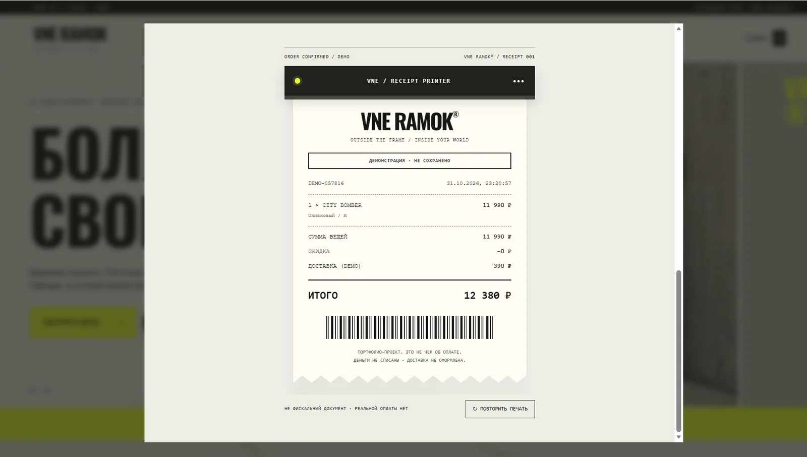

# VNE RAMOK — Screenshot gallery

Screenshots captured from the publicly running project on 31 October 2026. Captures are still frames; motion is best demonstrated in a separate screen recording.

## Home / streetwear hero

## New Drop / interactive product stack

## Editorial Lookbook / clickable outfit

## 3D Outfit Studio / current capture

## DROP PASS / interactive badge

## Category selector

## Brand manifesto and footer

## Demo checkout

## Animated receipt final frame

## Notes for portfolio use

- The **3D Studio** screenshot currently cuts off much of the lower body and captures the model in a rather flat view. Retake it with a slightly rotated model, the entire mannequin visible, and the clothing options beside it. Prefer this new screenshot as the showcase thumbnail when available.
- The LOOKBOOK capture was cropped at the top to remove a partially clipped heading; the interactive hotspots remain visible.
- The receipt screenshot shows only the final frame of the animation. Record the receipt **emerging** for the video.
- Do not show real contact information, login credentials or admin data in any public capture.
